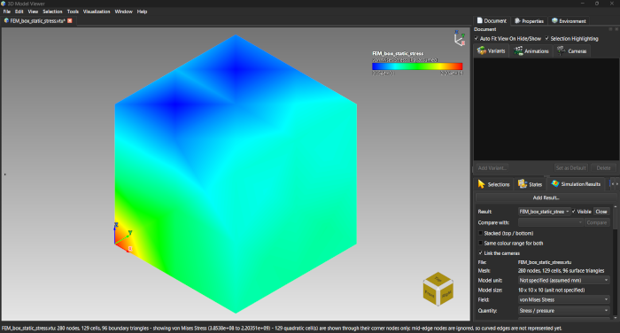
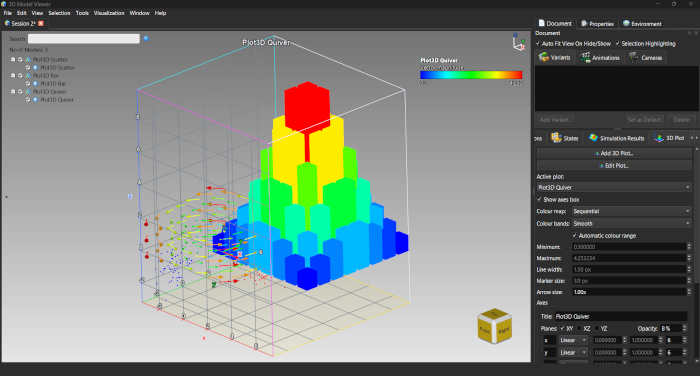
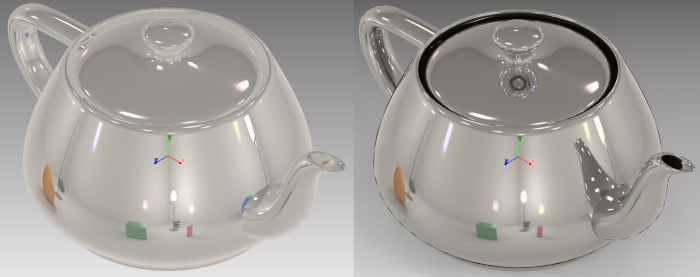

# ModelViewer
OpenGL-based 3D Model Viewer with Advanced Rendering Capabilities

A professional-grade 3D viewer that reads and displays a comprehensive range of 3D file formats supported by Assimp (OBJ, FBX, COLLADA, BLEND, and more) and CAD formats, including STEP, IGES, and BRep files via OpenCASCADE. Features physically-based rendering (PBR), advanced material systems with Khronos KHR extensions, and sophisticated CAD visualization capabilities.

## What's new in 2026.11

ModelViewer now reads **simulation results** (FEM / CFD) and plots **your own data in 3D**, and adds a **ray tracer**, **measurement and annotation**,
**CGAL-based mesh tools** and **surface analysis**. See the [changelog](CHANGELOG.md) for the full list, the in-app **Help > What's New** and
**Help > Tutorial** (29 lessons in English, German, Spanish, French and Italian), and the PDF guide *Simulation Results and 3D Plotting*:
[English](docs/guide/ModelViewer_Simulation_and_3D_Plotting_Guide.pdf), [Deutsch](docs/guide/ModelViewer_Simulation_and_3D_Plotting_Guide_de.pdf),
[Español](docs/guide/ModelViewer_Simulation_and_3D_Plotting_Guide_es.pdf), [Français](docs/guide/ModelViewer_Simulation_and_3D_Plotting_Guide_fr.pdf),
[Italiano](docs/guide/ModelViewer_Simulation_and_3D_Plotting_Guide_it.pdf).

## Download

The [releases page](https://github.com/sharjith/ModelViewer-Qt/releases) has a **Windows installer** (`.exe`) and a **Linux `.deb`** for Ubuntu 26.04 LTS
(`sudo apt install ./modelviewer_2026.11.0_amd64.deb`). To build from source see [Building the Code](#building-the-code).

### Optional content packs (full material library, all HDRI maps)

To keep the download small, the installer and the `.deb` include only a starter set: **19 materials** (the common metals, plastics, rubber, wood, stone, paper, denim
and a clear-coated paint), **23 environment maps** (indoor studios, clear and overcast skies, sunset, night and an urban street; about 320 MB) and the sample models. The complete libraries are separate
downloads on the same releases page. Every zip contains paths that start at `textures\...` or `sample-models\...`, and each carries a `README.txt` with the same steps.

| Download | Adds | Size |
|---|---|---|
| `ModelViewer-MaterialLibrary-2026.11.0-part1.zip` and `-part2.zip` | All ~129 material presets (`textures/materials`). Download **both** parts | about 2.2 GB in total |
| `ModelViewer-EnvironmentMaps-2026.11.0.zip` | Every HDRI environment map pack | about 1.0 GB |
| `ModelViewer-LargeSamples-2026.11.0.zip` | Million-cell stress-test results for the simulation readers (optional) | about 320 MB |

`SHA256SUMS.txt` on the releases page lists the checksum of each zip.

**Install a pack** (close ModelViewer first). Unzip it **into the ModelViewer data folder** so that the `textures` (or `sample-models`) folder in the zip merges with the one
already there:

- **Windows**: the data folder is `<install folder>\share\ModelViewer` - by default `C:\Program Files\ModelViewer\share\ModelViewer` (or
  `%LOCALAPPDATA%\Programs\ModelViewer\share\ModelViewer` if you installed for the current user only). Unzipping into `C:\Program Files` needs administrator rights, e.g.
  in an elevated PowerShell:
  ```powershell
  Expand-Archive -Force ModelViewer-MaterialLibrary-2026.11.0-part1.zip "C:\Program Files\ModelViewer\share\ModelViewer"
  Expand-Archive -Force ModelViewer-MaterialLibrary-2026.11.0-part2.zip "C:\Program Files\ModelViewer\share\ModelViewer"
  Expand-Archive -Force ModelViewer-EnvironmentMaps-2026.11.0.zip "C:\Program Files\ModelViewer\share\ModelViewer"
  ```
- **Linux** (`.deb`): the data folder is `/usr/share/ModelViewer`:
  ```bash
  sudo unzip -o ModelViewer-MaterialLibrary-2026.11.0-part1.zip -d /usr/share/ModelViewer
  sudo unzip -o ModelViewer-MaterialLibrary-2026.11.0-part2.zip -d /usr/share/ModelViewer
  sudo unzip -o ModelViewer-EnvironmentMaps-2026.11.0.zip -d /usr/share/ModelViewer
  ```

Restart ModelViewer: the new materials appear in the Material panel library and the new maps in the Environment panel. Existing files are simply overwritten with identical
content, so a pack can be applied again safely. Packs are built with `packaging/make-content-packs.ps1` (see the script header).

**ADS Mode for CAD Visualization**


**PBR Mode for Advanced Visualization**


## Features Overview

### Simulation Results

ModelViewer **displays** the results of FEM and CFD solvers; it does not mesh or solve. A result opens as its outer surface coloured by any field, and the
tools below look inside it.



- **Readers**: VTK (`.vtk`, `.vtu`), CalculiX `.frd`, Exodus II, CGNS, MED, OpenFOAM cases, VTKHDF; large results load step by step
- **Fields**: node and cell data, vectors, tensors, derived stress fields (von Mises, Tresca, principal, maximum shear), units with a file and a display unit
- **Display**: colour maps and ranges, contour bands, deformed shape, min/max markers, vector arrows, stress ellipsoids, a timeline with playback
- **Looking inside**: plane sections, iso-surfaces, streamlines, volume rendering, hover probe, charts over time and along a line (with your own curves from CSV)
- **Compare** two results side by side; save results inside an `.mvf` session

### 3D Data Plotting

Plot tables of numbers, formulas and time series in the same 3D scene as your models, with the same camera, section, annotation and export tools.



- **Plot types**: surface, contour, line, scatter, bar / histogram, voxel, vector field, pathlines, image on a plane
- **Sources**: CSV or pasted data, and formulas (surface, parametric surface and curve, implicit surface, vector field, streamlines, pathlines) with presets
- **Shared axes** (linear, Log 10, SymLog), fills between curves, text notes, a section probe, animated pathlines, edit-in-place, glTF/GLB/OBJ export of point and line plots

### Ray Tracing

A physically based ray tracer with a CPU engine (Embree) and an optional GPU engine (NVIDIA OptiX), a live ray-traced viewport, offline renders of any size,
OIDN denoising and batch rendering of captured views.



### Measure, Annotate and Report

Point, distance, angle, radius, diameter, pitch-circle, area and geodesic measurements with CAD-style dimension lines, text annotations, and a PDF report of
captured views with their measurement and annotation table.

### Mesh Tools and Surface Analysis

- **Editing**: Mesh Union (boolean), Shrink Wrap, Subdivide Surface, Reconstruct Surface from point clouds, Repair Mesh, Fill Holes, split / merge / group, UV generation
- **Analysis**: draft angle, zebra stripes, curvature, wall thickness, deviation, and mass properties (volume, mass, centre of gravity) per mesh and material

### Rendering Modes & Visualization

ModelViewer supports a comprehensive range of visualization and rendering styles for different inspection and analysis needs:


- **Solid Shading**: Standard surface rendering
- **Wireframe**: Edge visualization for topology inspection
- **Wireframe Overlay**: Wireframe on solid for combined visualization
- **Vertex Colors**: Direct vertex color visualization from model data
- **ADS (Ambient-Diffuse-Specular)**: Traditional Phong-based lighting model

### Advanced Rendering Modes
**Metallic Roughness, Transmission, and Volume**

**Sheen, Alpha Coverage**


- **Physically-Based Rendering (PBR)**: Full Cook-Torrance BRDF implementation with metallic/roughness workflows
- **Split-Sum IBL**: Image-based lighting with irradiance and prefiltered environment maps
- **Shadow Mapping**: PCF-based shadow filtering with support for directional, point, and spot lights
- **Parallax/Bump Mapping**: Height-based surface detail rendering
- **Texture-Based PBR**: Material properties driven by texture maps (albedo, normal, roughness, metallic, AO)

### Material System & KHR Extensions

ModelViewer implements comprehensive support for Khronos KHR material extensions, enabling advanced material rendering capabilities:


**Supported KHR Material Extensions:**

- **KHR_materials_clearcoat**: Multi-layer clearcoat materials with independent roughness control (see automotive paint rendering below)
- **KHR_materials_sheen**: Fabric-like materials with directional sheen highlights
- **KHR_materials_transmission**: Transparent materials with refraction and realistic light transmission
- **KHR_materials_volume**: Volumetric absorption for thick transparent materials with realistic light scattering
- **KHR_materials_iridescence**: Iridescent/interference-based color shifts (thin-film interference) (see automotive paint rendering below)
- **KHR_materials_dispersion**: Chromatic aberration with per-channel IOR for realistic prism effects
- **KHR_materials_specular**: Fine-grained specular intensity and color control
- **KHR_materials_anisotropy**: Directional surface reflection (brushed metals, fabrics)
- **KHR_materials_diffuse_transmission**: Subsurface scattering for translucent materials
- **KHR_materials_pbrSpecularGlossiness**: Legacy PBR specular/gloss workflow support
- **KHR_lights_punctual**: Multiple punctual light sources (directional, point, spot) with intensity control

**Visual Demonstrations of KHR Material Extensions:**


**KHR Punctual Lights Support:**


**Texture Transform Support:**

- **KHR_texture_transform**: Full implementation of UV coordinate transformations, including:
  - UV scaling and rotation
  - Offset (translation) around pivot points
  - Multi-UV coordinate set support
  - Per-texture transform customization


### Material Editor & Library System

- **Interactive Material Editor Panel**: Real-time material property adjustment with live preview
- **Material Library**: Tree-based organization and management of materials
- **Material Deduplication**: Intelligent identification and consolidation of duplicate materials
- **Name-Based Material Matching**: Preservation of original material names across the import/export pipeline


### Texture Management & Advanced Features

**Texture Processing:**

- **Automatic Embedding**: Textures embedded directly into GLB exports for self-contained models
- **Smart Texture Caching**: Three-level lookup system (exact match → same image/different sampler → disk load) with sampler-aware cache keys
- **Texture Format Support**:
  - KTX2 and Basis Universal compressed textures
  - WebP format with automatic plugin deployment
  - Standard formats (PNG, JPG, TGA, BMP)
- **Texture Transform**: Per-texture UV transformation with full KHR_texture_transform support
- **Multi-Channel Support**: Independent handling of multiple texture sets and UV coordinates


### CAD Support & Assembly Visualization

**OpenCASCADE Integration:**

- **Native STEP Support**: Full parametric feature preservation
- **IGES Files**: Industry-standard CAD format support
- **BRep Format**: OpenCASCADE native boundary representation
- **Color Inheritance**: Smart color extraction from XCAF color attributes with intelligent inheritance chains
- **Property Preservation**: Metadata and naming preserved across the import pipeline

**Assimp Integration:**

- **Multi-Format Support**: OBJ, FBX, COLLADA, Blend, VRML, and 30+ other formats
- **Robust Loading**: Handles malformed files gracefully with validation
- **Mesh Post-Processing**: Automatic tangent/bitangent computation with proper transformation math
- **Negative Scale Handling**: Correct detection and processing of flipped geometry via determinant-based matrix analysis

### Export Capabilities

- **GLB Export Pipeline**: Complete round-trip export with:
  - Material preservation and deduplication
  - Texture embedding with optimized packing
  - KHR extension metadata preservation
  - Correct handling of negative scales and transforms
  - Sampler value preservation across materials
- **Texture Embedding**: Automatic embedding before export for portable model files
- **Format-Agnostic Export**: Support for exporting to multiple target formats

### Section/Capping Tools

**Advanced Sectioning:**

- **Single Plane Section**: Cut models with arbitrary clipping planes
- **Multiple Section Views**: Simultaneous display of multiple cross-sections with automatic capping
- **Smart Capping**: Automatic generation of capping geometry to close intersected surfaces
- **Interactive Adjustment**: Real-time plane manipulation for dynamic sectioning


### Multi-View Projection System

- **Multiple Synchronized Views**: Side-by-side or grid-based orthographic projections
- **Standard Projections**: Front, back, top, bottom, left, right, isometric views
- **Anonometric Projections**: Isometric, Dimetric, and Trimetric
- **Orthographic and Perspective Projections**


### Realistic PBR Rendering

**Realistic Automotive Paint Rendering (Clearcoat & Iridescence):**


### User Interface & Tools

**Detachable Panels:**

- **Texture Mapping Panel**: Interactive UV transformation and texture coordinate visualization
- **Material Editor Panel**: Comprehensive material property adjustment interface
- **Log Viewer**: Real-time application logging with syntax highlighting, search, and filtering by log level
- **Material Library Panel**: Tree-based material organization and management

**UI Features:**

- **Qt6 MDI Interface**: Multiple document/model windows with tabbed organization
- **Scrollable Toolbar**: Customizable tool access with context-sensitive actions
- **Theme Manager**: Light and dark theme support with customizable color schemes
- **Settings Dialog**: Comprehensive application configuration and user preferences
- **Tutorial System**: Interactive guided introduction for new users
- **Internationalization Support**: English, Spanish, French, Italian, and German

### Advanced Camera & Navigation

- **Orbital Camera**: Smooth mouse-based model rotation and inspection
- **Pan & Zoom**: Intuitive view navigation with proper zoom mechanics
- **Preset Views**: Quick access to standard orthographic projections
- **Light Manipulation**: Independent light repositioning with delta-based targeting
- **Perspective Correction**: Proper NDC Z-clamping for accurate behavior at high zoom levels
- **CAD Coordinate System**: Native Z-up orientation matching industry CAD standards

### Undo/Redo System

- **Full Command History**: Complete undo/redo stack for all editing operations
- **Live Preview Updates**: Synchronized UI panel updates on undo/redo actions
- **Material Operations**: Support for complex material editing operations with full history

## Architecture

### Dual Rendering Pipeline

ModelViewer implements a sophisticated dual-pipeline rendering system:

- **ADS Pipeline**: Traditional Ambient-Diffuse-Specular (Phong) lighting for fast, simple rendering
- **PBR Pipeline**: Physically-based rendering with Cook-Torrance BRDF for photorealistic materials
- **Seamless Switching**: Real-time mode switching with automatic shader compilation and resource management

### Coordinate System

- **Z-Up Convention**: Native support for industry-standard CAD coordinate systems
- **Proper Environment Mapping**: Custom cubemap orientation handling for refraction-based display correction
- **Transform Preservation**: Accurate transformation matrices throughout the pipeline

### Rendering Infrastructure

**Image-Based Lighting (IBL):**

- **Equirectangular to Cubemap**: Efficient fullscreen triangle-based conversion (eliminating seam artifacts)
- **Irradiance Convolution**: Frisvad orthonormal basis with optimized sampling for diffuse IBL
- **Prefilter Maps**: Multi-level roughness-dependent prefiltering with proper BRDF LUT integration
- **Split-Sum Approximation**: Optimized two-pass IBL computation for real-time performance

**Shadow Mapping:**

- **PCF Filtering**: Percentage-closer filtering for soft shadows
- **Multi-Light Support**: Proper shadow rendering for directional, point, and spot lights
- **Orthographic Projection**: Bounding sphere-based frustum computation for shadow consistency

**Mesh & Transform System:**

- **Tangent Space Correction**: Proper tangent/bitangent transformation using inverse-transpose math
- **Negative Scale Handling**: Determinant-based detection with automatic normal/tangent/bitangent flipping
- **Transform Composition**: Accurate hierarchical transform chains for assembly structures

## Supported File Formats

### 3D Model Formats (via Assimp)

OBJ, FBX, COLLADA, Blender, VRML, STL, DAE, 3DS, IQM, XGL, ZGL, PLY, MS3D, LWO, LWS, Ogex, 3D, Q3O, Q3S, raw, STP, and more (30+ formats supported)

### CAD Formats (via OpenCASCADE)

- **STEP** (.step, .stp) - Complete feature preservation with assembly support
- **IGES** (.iges, .igs) - Industry-standard CAD interchange format
- **BRep** (.brep) - OpenCASCADE native boundary representation format

### Simulation Result Formats

VTK legacy and XML (`.vtk`, `.vtu`), CalculiX (`.frd`), Exodus II, CGNS, MED, OpenFOAM cases (`.foam`) and VTKHDF. Plot data comes from CSV files or pasted text.

### Export Formats

- **PDF report** - captured views with the measurement and annotation table; **PNG / CSV** for charts
- **GLB** (.glb) - Binary glTF with full material and texture embedding
- **glTF** (.gltf) - Khronos glTF format with separate texture resources

## Building the Code

### Prerequisites

Ensure you have the following installed:

- **CMake**: Version 3.15 or above
- **Qt**: Version 6.8 or above (with OpenGL support)
- **Assimp**: Version 5.0.1 or compatible
- **GLM**: Mathematics library for graphics
- **Freetype**: Version 2.10.1 or compatible (for text rendering)
- **OpenCASCADE**: Version 7.9 or compatible (for CAD support)
- **Mesh Optimizer**: Mesh optimization library
- **Basis Universal™**: To support the intermediate .KTX2 file formats
- **vcpkg**: Package manager (Windows builds)

### Linux Build

#### Ubuntu 26.04 LTS / Kubuntu 26.04 (the platform of the `.deb`)

This is the supported route and builds the same package that is published on the releases page. Ubuntu 26.04's Qt, OpenCASCADE and Assimp are new enough; older
releases (22.04 / 24.04) are not.

```bash
# 1. clone (or, in an existing clone: git fetch origin && git checkout dev && git pull) and fetch the submodules
git clone --branch dev https://github.com/sharjith/ModelViewer-Qt.git ~/dev/ModelViewer-Qt
cd ~/dev/ModelViewer-Qt
git submodule update --init --recursive

# 2. one-time setup: apt packages, CGAL 6.2 from cgal.org (needs sudo), vcpkg for the two bundled dependencies
bash packaging/linux/setup-wsl-build-env.sh

# 3. configure and build
cmake --preset linux_system_release
cmake --build out/build/linux_system_release --parallel

# 4. make the .deb, install it and start the program
cd out/build/linux_system_release && cpack -G DEB
sudo apt install ./modelviewer_2026.11.0_amd64.deb
modelviewer
```

Notes: the script is named after WSL but runs on any Ubuntu 26.04 system. Build the whole project (no `--target ModelViewer`), or `cpack` cannot find the icon. For
NVIDIA graphics install the driver first (`sudo ubuntu-drivers install`) and check `glxinfo -B` names your card rather than `llvmpipe`. The optional material, HDRI and
sample packs are unzipped into `/usr/share/ModelViewer` (see [Optional content packs](#optional-content-packs-full-material-library-all-hdri-maps)).

#### Other Linux distributions

1. Install required dependencies using your package manager:

   ```bash
   # Ubuntu/Debian
   sudo apt-get install cmake qt6-base-dev libassimp-dev libglm-dev \
     libfreetype6-dev libopencascade-dev

   # Fedora/RHEL
   sudo dnf install cmake qt6-base-devel assimp-devel glm-devel \
     freetype-devel opencascade-devel
   ```

   **Ubuntu 26.04 LTS:** the full dependency list (including the Qt, OpenCASCADE, embree and Boost/GMP/MPFR/Eigen packages the project needs) is installed by
   `packaging/linux/setup-wsl-build-env.sh`; it also installs **CGAL 6.2 or newer** from cgal.org. This one cannot come from apt: Ubuntu 26.04's
   `libcgal-dev` is 6.1.x, and the configure step stops with a message if it finds a CGAL older than 6.2. CGAL is header-only, so to do it by hand:

   ```bash
   curl -LO https://github.com/CGAL/cgal/releases/download/v6.2.1/CGAL-6.2.1-library.tar.xz
   tar -xf CGAL-6.2.1-library.tar.xz
   cmake -S CGAL-6.2.1 -B cgal-build -DCMAKE_BUILD_TYPE=Release
   sudo cmake --install cgal-build --prefix /usr/local     # or any prefix, then pass -DCGAL_DIR=<prefix>/lib/cmake/CGAL
   ```

2. Clone the repository:

   ```bash
   git clone https://github.com/sharjith/ModelViewer-Qt.git
   cd ModelViewer-Qt
   ```

3. Create a build directory and configure the project:

   ```bash
   mkdir build
   cd build
   cmake .. -DCMAKE_BUILD_TYPE=Release
   ```

4. Build the project:

   ```bash
   make -j$(nproc)
   ```

5. Run the application:

   ```bash
   ./ModelViewer
   ```

### Windows Build

1. Install vcpkg (if not already installed):

   ```bash
   git clone https://github.com/Microsoft/vcpkg.git
   cd vcpkg
   .\bootstrap-vcpkg.bat
   ```

2. Install required dependencies via vcpkg:

   ```bash
   .\vcpkg install qt6-base:x64-windows assimp:x64-windows glm:x64-windows \
     freetype:x64-windows opencascade:x64-windows
   ```

3. Clone the repository:

   ```bash
   git clone https://github.com/sharjith/ModelViewer-Qt.git
   cd ModelViewer-Qt
   ```

4. Create a build directory and configure with CMake:

   ```bash
   mkdir build
   cd build
   cmake .. -DCMAKE_TOOLCHAIN_FILE=[path_to_vcpkg]/scripts/buildsystems/vcpkg.cmake ^
     -DCMAKE_BUILD_TYPE=Release
   ```

   Replace `[path_to_vcpkg]` with your vcpkg installation path (e.g., `C:\vcpkg`).

5. Build the project:

   ```bash
   cmake --build . --config Release -j %NUMBER_OF_PROCESSORS%
   ```

6. Run the application:

   ```bash
   .\Release\ModelViewer.exe
   ```

### macOS Build

1. Install dependencies via Homebrew:

   ```bash
   brew install cmake qt@6 assimp glm freetype open-cascade
   ```

2. Clone and build:

   ```bash
   git clone https://github.com/sharjith/ModelViewer-Qt.git
   cd ModelViewer-Qt
   mkdir build
   cd build
   cmake .. -DCMAKE_BUILD_TYPE=Release -DCMAKE_PREFIX_PATH=$(brew --prefix qt@6)
   make -j$(sysctl -n hw.ncpu)
   ./ModelViewer.app/Contents/MacOS/ModelViewer
   ```

## Troubleshooting

### Common Build Issues

**OpenGL Context Not Available**
- Ensure your system has a compatible GPU with OpenGL 4.6+ support
- On Linux, verify GPU drivers are properly installed (`glxinfo` can help diagnose)

**Qt6 Configuration Issues**
- Verify Qt6 is properly installed: `qmake --version` should show Qt 6.8+
- On Linux, ensure `qt6-base-dev` is installed with OpenGL support
- On Windows, verify vcpkg Qt6 installation: `vcpkg list | grep qt6`

**Assimp Version Mismatch**
- Ensure Assimp 5.0.1 or later is installed
- Incompatible versions may cause linking errors or runtime crashes
- Rebuild Assimp from source if package manager version is outdated

**OpenCASCADE Not Found**
- On Linux: Verify installation with `pkg-config --cflags --libs OpenCASCADE`
- On Windows: Ensure vcpkg installation completed successfully
- Check CMake output for exact library names not found

**CMake Cannot Find Dependencies**
- On Linux: Set `CMAKE_PREFIX_PATH` to dependency locations
  ```bash
  cmake .. -DCMAKE_PREFIX_PATH=/usr/local -DCMAKE_BUILD_TYPE=Release
  ```
- On Windows: Verify vcpkg triplet matches your build (x64-windows, x86-windows, etc.)

**OpenGL-Related Crashes**
- Ensure shaders compile successfully (check application logs)
- Verify all texture formats are supported by your GPU
- Try updating GPU drivers

### Performance Tips

- Use **Release builds** (`-DCMAKE_BUILD_TYPE=Release`) for best performance
- **Reduce shadow map resolution** if rendering is slow
- **Disable unused KHR extensions** in settings if not needed
- **Use LOD variants** for very large assemblies or point clouds
- **Prefilter maps** are computed on load; large environment maps may take time

### Dependency Compatibility

**Recommended Versions:**
- Qt: 6.8 or later
- Assimp: 5.0.1 or later (5.2+ recommended)
- OpenCASCADE: 7.9 or later
- CMake: 3.16 or later (3.24+ recommended)
- GLM: 0.9.9 or later
- MeshOptimizer
- BasisU™

**Known Issues:**
- OpenCASCADE < 7.8 may have compatibility issues
- Qt versions older than 6.6 lack some OpenGL optimizations
- MSVC 2019 or later recommended for Windows builds

## Development & Contribution

ModelViewer is built with modern C++ (C++17) and uses CMake as its build system. The project includes:

- **Comprehensive Shader System**: Custom GLSL shader pipeline with hot-reloading support
- **Qt6 Integration**: Complete integration with Qt6 for UI, threading, and context management
- **Assimp Post-Processing**: Custom mesh processing for improved compatibility and quality
- **OpenGL 4.6**: Modern graphics pipeline with compute shader support

## License

ModelViewer is licensed under the GNU General Public License v3.0 (GPL-3.0).

This program is free software: you can redistribute it and/or modify it under the terms of the GNU General Public License as published by the Free Software Foundation, either version 3 of the License, or (at your option) any later version.

This program is distributed in the hope that it will be useful, but WITHOUT ANY WARRANTY; without even the implied warranty of MERCHANTABILITY or FITNESS FOR A PARTICULAR PURPOSE. See the GNU General Public License for more details.

You should have received a copy of the GNU General Public License along with this program. If not, see <https://www.gnu.org/licenses/>.

For the full license text, see the [LICENSE](LICENSE) file in the repository root.

## Acknowledgments

- [Assimp](https://github.com/assimp/assimp) - Asset import library
- [OpenCASCADE](https://www.opencascade.com/) - CAD geometry kernel
- [Qt](https://www.qt.io/) - GUI framework
- [GLM](https://github.com/g-truc/glm) - Mathematics library
- [Khronos](https://www.khronos.org/) - glTF and KHR extension specifications
- [CGAL](https://www.cgal.org/) - Computational Geometry Algorithms Library (mesh repair, boolean union, shrink wrap, subdivision, analysis)
- [Embree](https://www.embree.org/) and [Intel Open Image Denoise](https://www.openimagedenoise.org/) - ray tracing and denoising
- [NVIDIA OptiX](https://developer.nvidia.com/rtx/ray-tracing/optix) - optional GPU ray tracing
- [NetCDF](https://www.unidata.ucar.edu/software/netcdf/), [HDF5](https://www.hdfgroup.org/solutions/hdf5/) and [CGNS](https://cgns.github.io/) - simulation result readers
- [Eigen](https://eigen.tuxfamily.org/), [Boost](https://www.boost.org/), [GMP](https://gmplib.org/) and [MPFR](https://www.mpfr.org/) - numerics used by CGAL
- [meshoptimizer](https://github.com/zeux/meshoptimizer), [Basis Universal](https://github.com/BinomialLLC/basis_universal), [OpenEXR](https://openexr.com/), [zstd](https://facebook.github.io/zstd/) and [FreeType](https://freetype.org/)
- Tutorial image for ray tracing: "Car Concept" by Eric Chadwick, CC BY 4.0, from the [Khronos glTF Sample Assets](https://github.com/KhronosGroup/glTF-Sample-Assets) (see [CREDITS.md](CREDITS.md))
